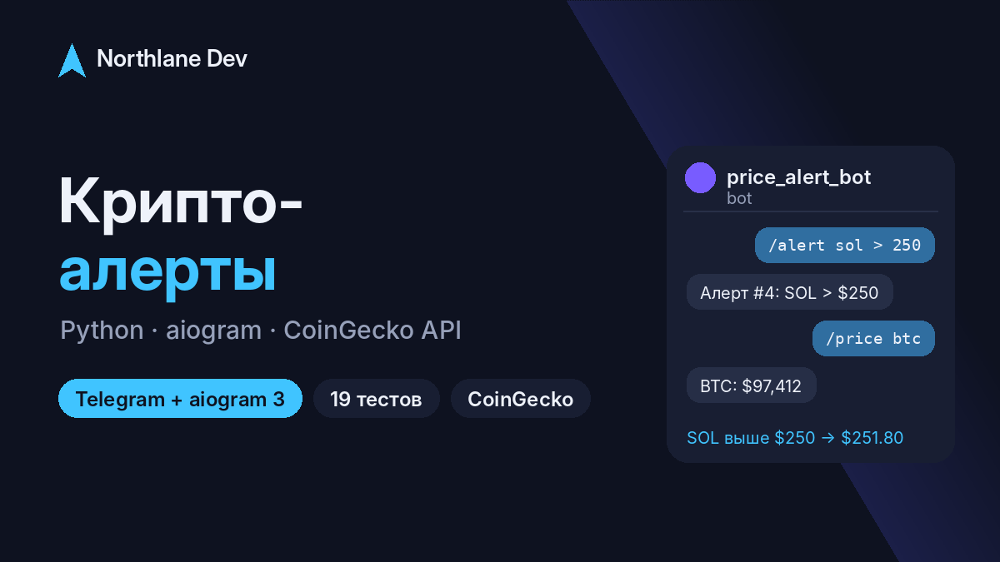

# Crypto Alert Bot — цены и уведомления по криптовалютам в Telegram



> **EN:** Telegram bot for crypto prices and price alerts: `/price btc eth`, `/alert btc > 70000`, repeating alerts, per-chat limits. Prices for all tracked coins come in one batched CoinGecko request with caching. Python 3.11+, aiogram 3, SQLite. Core covered by 19 unit tests.

Бот показывает цены монет и присылает уведомление, когда цена пересекает заданный уровень. Работает в личке и в группах.

## Команды

| Команда | Что делает |
|---|---|
| `/price btc eth sol` | цены нескольких монет |
| `/alert btc > 70000` | уведомить, когда BTC дороже 70 000 $ |
| `/alert eth < 3000 repeat` | повторяющийся алерт: срабатывает при каждой проверке, пока условие выполнено |
| `/alerts`, `/del 3`, `/clear` | список, удаление одного, удаление всех |
| `/coins` | поддерживаемые монеты |

## Как устроено

- Все цены для всех алертов запрашиваются **одним** запросом к CoinGecko и кэшируются, поэтому бот укладывается в бесплатный лимит API даже при сотнях алертов
- Разовые алерты удаляются после срабатывания; если пользователь заблокировал бота, его алерты очищаются
- Не больше 20 алертов на чат, понятные ошибки на русском
- Сетевые сбои не роняют фоновую проверку

```
app/core.py     # разбор команд, SQLite, провайдер цен с кэшем, логика срабатывания
app/main.py     # команды Telegram и фоновый цикл проверки
tests/          # 19 тестов ядра (HTTP подменён, часы подменены)
```

## Запуск

```bash
pip install -r requirements.txt
cp .env.example .env     # токен от @BotFather
python -m app.main
```

Тесты: `pip install pytest && pytest -q`

## Что можно добавить

Цены с бирж (Binance, Bybit, OKX) через WebSocket, алерты на процент изменения за период, графики, курсы в тенге и рублях, подписка с оплатой через Telegram Stars.

---
Демо-проект из портфолио **Northlane Dev** · лицензия MIT
